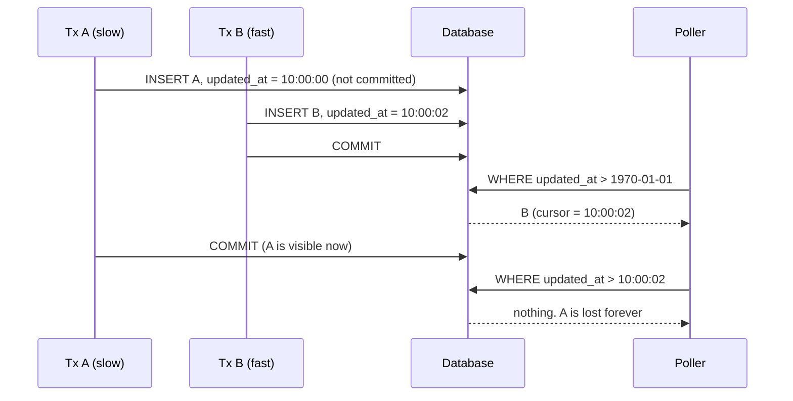

# Your `updated_at` column isn't the problem. Your cursor is.

A small, **deterministic** proof that cursor-based change detection silently loses data,
and that the fix is not "use IDs instead of timestamps".

Runs on **PostgreSQL** and **MariaDB**. No threads, no sleeps, no flaky timing: every run, same result.

## The problem in one picture

Many systems sync changes to a search index, cache or warehouse like this:

```sql
SELECT * FROM item WHERE updated_at > :lastSeen ORDER BY updated_at
```

`updated_at` is set when the statement **runs**. The row becomes visible when the
transaction **commits**. A slow transaction can therefore make a row visible whose
timestamp is already behind the cursor:



No error, no failed job, no log entry. The record is simply never synchronized.

## The twist: IDs fail in exactly the same way

The usual reaction is "clocks are unreliable, let's use the auto-increment id". But the id is
allocated at **insert** time, not at commit time. Scenario 2 shows the identical loss with no
clock involved at all.

The real rule is:

> **Never use a value that is assigned before commit (timestamp *or* sequence) as a cursor
> that decides what has already been processed.**

## The scenarios

All scenarios live in [`LateCommitScenarios`](src/test/java/com/example/latecommit/LateCommitScenarios.java)
and run unchanged against both databases.

| # | Strategy | Late commit (A) | What it shows |
|---|---|---|---|
| 1 | [Timestamp cursor](src/main/java/com/example/latecommit/TimestampCursorFeed.java) | ❌ lost | The classic bug |
| 2 | [Id cursor](src/main/java/com/example/latecommit/IdCursorFeed.java) | ❌ lost | Same bug, no clock involved |
| 3 | [Look-back window](src/main/java/com/example/latecommit/LookBackWindowFeed.java) (5 s), short transaction | ✅ delivered | The common "fix" works ... |
| 4 | Look-back window (5 s), transaction open for 60 s | ❌ lost | ... until a transaction outlives the window |
| 5 | [Transactional outbox](src/main/java/com/example/latecommit/OutboxFeed.java) | ✅ delivered | No cursor to fall behind |

The suite is **green when the documented behaviour happens**, including the broken behaviour.
Every test is executable documentation of one failure mode or of its fix.

## Why the outbox works

Each change writes a marker row **in the same transaction** as the change itself:

```java
connection.setAutoCommit(false);
Items.insertWithOutbox(connection, "A", now);   // INSERT item + INSERT outbox
connection.commit();                            // both visible together, or neither
```

The poller delivers whatever markers exist and deletes them afterwards. Nothing summarizes
"everything up to here is done", so there is nothing a late commit could fall behind. The
marker's timestamp is irrelevant: scenario 5 stamps it an hour in the past on purpose.

## How the tests stay deterministic

Three JDBC connections play three roles, and the test decides the order of events:

```java
slow.setAutoCommit(false);
Items.insert(slow, "A", at(0));                       // written first, NOT committed

Items.insert(fast, "B", at(2));                       // written later, committed immediately

assertThat(feed.poll(poller)).containsExactly("B");   // poller sees committed data only

slow.commit();                                        // A becomes visible ... behind the cursor

assertThat(feed.poll(poller)).isEmpty();              // ... and is never read
```

This relies only on a guarantee every mainstream database gives by default: a reader never
sees uncommitted rows. The poller runs in autocommit mode, so each poll is a fresh transaction.

## Run it

Requirements: Java 21, Maven 3.9+, Docker (for Testcontainers).

```bash
mvn verify
```

The first run pulls `postgres:17-alpine` and `mariadb:11.4`.

## Is every timestamp bad, then?

No. Ask one question:

> *If this value is a few seconds off, or a transaction commits late, do I **lose data**,
> or do I just get it **later**?*

Timestamps are fine for audit fields, retry delays, leases, lag metrics, and batch jobs over
periods that are already closed. They are only dangerous as a **cursor for change detection**.

The two correct patterns for change detection:

1. **Track every change individually until it is acknowledged** (transactional outbox, this repo).
2. **Follow a position that is ordered by commit**, such as the transaction log (CDC, e.g. Debezium).

## Scope

This is a teaching project. The outbox feed is intentionally minimal: one poller,
at-least-once delivery. Several concurrent pollers would claim markers with
`SELECT ... FOR UPDATE SKIP LOCKED`, together with a lease and retries.
